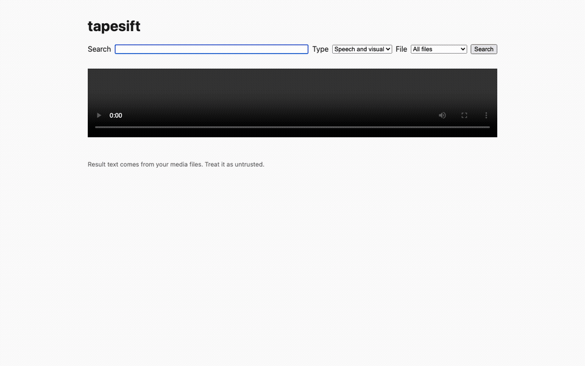

# tapesift

Self-hosted engine that turns hours of video and audio into searchable, timestamped data, at the lowest cost per hour.

> Status: pre-release (v0.1 in progress). Index, search and a local web UI work on CPU; not yet on PyPI, so install from source. The build plan lives in [docs/spec.md](docs/spec.md).

## Demo



Searching "AI summary" in the local web UI returns speech and visual hits with timestamps; clicking one plays the video from that moment ([MP4](docs/media/demo.mp4)).

```bash
tapesift index <folder> --out out/
tapesift search "..." --out out/
tapesift serve --out out/
```

Demo video: ["Humans define Wikipedia's values and ethics"](https://commons.wikimedia.org/wiki/File:Humans_define_Wikipedia%27s_values_and_ethics.webm) by Lane Rasberry (Wikimedia Commons user Bluerasberry), [CC BY 4.0](https://creativecommons.org/licenses/by/4.0/). Frames shown unmodified in a screen recording of the tapesift UI.

## What it will do

- Index a folder of video or audio on your own machine: laptop CPU, consumer NVIDIA GPU, or datacenter GPU.
- Transcribe speech with word timestamps, split shots, drop near-duplicate frames, caption only the frames that add something.
- Answer "find the moment where X is said or shown" from a CLI, a Python API, an HTTP API or an MCP server.
- Report its own throughput (video-hours per GPU-hour) and cost ($ per video-hour) with `tapesift bench`.

## Acceptable use

tapesift does **not** do face recognition, person identification, or tracking of named individuals, and never will. Pull requests adding them will be closed.

## Non-goals for v1.0

- No face recognition or person identification. Ever.
- No hosted service.
- No video generation or editing.
- No training of base models; only post-training of small open models.
- No real-time streaming; batch first.
- No Windows-native support; WSL2 is best effort.
- English only. Other languages are transcribed best effort, never evaluated.

## Privacy

No telemetry. The only network calls are model downloads, and `tapesift doctor` lists them.

## Development

Prerequisites: [uv](https://docs.astral.sh/uv/). ffmpeg and espeak-ng are needed only to regenerate fixtures (`make fixtures`).

```bash
gh repo clone jahnavi-yelamanchi/tapesift   # private for now
cd tapesift
uv sync --all-extras
make check
```

See [AGENTS.md](AGENTS.md) for the rules every contributor (human or agent) follows, and [docs/guides/setup.md](docs/guides/setup.md) for the full dev and cloud-compute setup.

## License

Apache-2.0. Third-party models and libraries are listed in [THIRD_PARTY.md](THIRD_PARTY.md).
